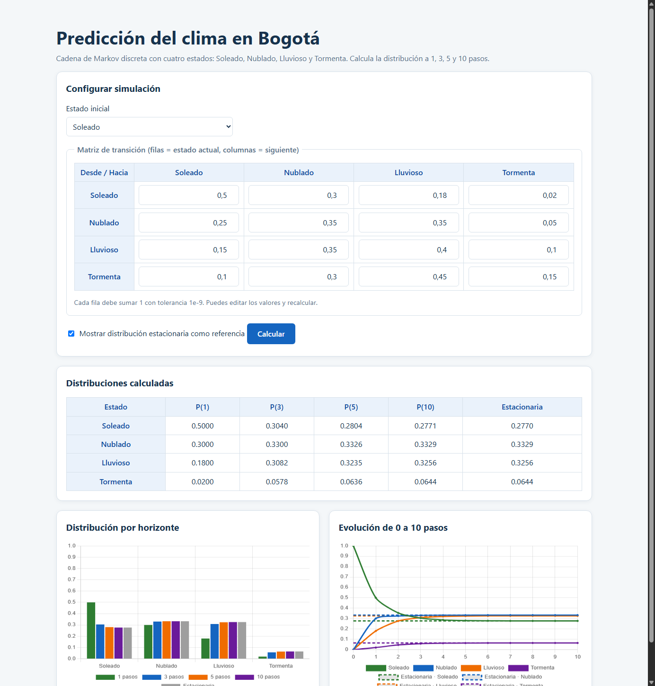

# Markov Clima · Bogotá

Aplicación web para predecir el clima diario en Bogotá mediante una **cadena de Markov discreta** de cuatro estados. El proyecto se construyó con **SDD (Spec-Driven Development)** usando **OpenSpec**: primero se aprobaron las especificaciones y después se escribió el código.

Repo: https://github.com/alejo-20/markov-clima

## 1. Problema

El clima cambia de un día a otro con dependencia del estado anterior. A partir de una matriz de transición conocida, queremos responder:

> Si hoy está Lluvioso, ¿cuál es la distribución de probabilidad del clima en 1, 3, 5 y 10 días?

Hacer estos cálculos a mano es repetitivo y propenso a errores, por lo que se automatiza el motor matemático, se expone por API y se visualiza en una interfaz web en español.

## 2. Fundamento matemático

Si `π₀` es un vector fila con la distribución inicial y `P` la matriz de transición (filas = estado actual, columnas = estado siguiente), entonces:

```text
π_n = π_0 · P^n
```

- Desde un estado inicial `i`, `π₀ = e_i` (vector unitario con 1 en la posición `i`).
- `P⁰ = I` y `P¹ = P`.
- La distribución estacionaria `π` cumple `π · P = π` y `∑π = 1`. Como todas las entradas de `P` son positivas, la cadena es regular y esa distribución es única; se estima con `P^1000` y se verifica que `‖π·P − π‖∞ < 1e-9`.
- Toda fila de `P` suma 1 con tolerancia `1e-9`.

## 3. Estados y matriz de transición

Estados: **Soleado, Nublado, Lluvioso, Tormenta**.

| Desde / Hacia | Soleado | Nublado | Lluvioso | Tormenta |
|---|---:|---:|---:|---:|
| **Soleado**  | 0.50 | 0.30 | 0.18 | 0.02 |
| **Nublado**  | 0.25 | 0.35 | 0.35 | 0.05 |
| **Lluvioso** | 0.15 | 0.35 | 0.40 | 0.10 |
| **Tormenta** | 0.10 | 0.30 | 0.45 | 0.15 |

Distribución estacionaria calculada (4 decimales):

| Soleado | Nublado | Lluvioso | Tormenta |
|---:|---:|---:|---:|
| 0.2770 | 0.3329 | 0.3256 | 0.0644 |

## 4. Instalación y ejecución

Requisitos: **Python 3.11+**.

### Windows (PowerShell)

```powershell
python -m venv venv
.\venv\Scripts\python.exe -m pip install -r requirements.txt
.\venv\Scripts\python.exe -m uvicorn app.main:app --reload
```

### Linux / macOS

```bash
python3 -m venv venv
source venv/bin/activate
pip install -r requirements.txt
uvicorn app.main:app --reload
```

Luego abre:

- Interfaz web: http://127.0.0.1:8000/
- Documentación interactiva (Swagger): http://127.0.0.1:8000/docs
- Modelo por defecto: http://127.0.0.1:8000/api/model

### Ejemplo de uso de la API

```powershell
Invoke-RestMethod -Method Post `
  -Uri "http://127.0.0.1:8000/api/predict" `
  -ContentType "application/json" `
  -Body '{"initial_state":"Lluvioso","steps":[1,3,5,10],"include_stationary":true}' |
  ConvertTo-Json -Depth 5
```

Respuesta (fragmento):

```json
{
  "distributions": {
    "1":  [0.15, 0.35, 0.40, 0.10],
    "3":  [0.26135, 0.33460, 0.33575, 0.06830],
    "5":  [0.275094025, 0.333135275, 0.326879125, 0.064891575],
    "10": [0.2770237, 0.3329288, 0.3256334, 0.0644140]
  },
  "stationary": [0.2770342, 0.3329277, 0.3256267, 0.0644115]
}
```

También se puede enviar `initial_vector` en lugar de `initial_state`, y una `matrix`/`states` propios. Las violaciones de reglas devuelven **HTTP 422** con un mensaje `detail` en español.

## 5. Pruebas

```bash
venv\Scripts\python.exe -m pytest -v --cov=app
```

Resultado verificado: **53 pruebas pasadas, cobertura total del 98 %** (`app/main.py` 98 %, `app/markov.py` 98 %).

Cada *Scenario* de las specs tiene al menos una prueba cuyo nombre incluye el identificador del requisito, por ejemplo:

- `test_ME_01_S3_fila_que_no_suma_uno_rechazada`
- `test_API_03_S4_entrada_mutuamente_excluyente_devuelve_422`
- `test_UI_02_S1_graficas_y_tabla_tras_calcular`

## 6. Estructura del repositorio

```text
markov-clima/
├─ app/
│  ├─ __init__.py
│  ├─ markov.py              # motor puro: validación, P^n, distribuciones, estacionaria
│  ├─ main.py                # FastAPI: /api/model, /api/predict, / y /static
│  └─ static/
│     ├─ index.html          # UI en español
│     ├─ styles.css          # diseño responsive
│     └─ app.js              # validación local, fetch y gráficas Chart.js
├─ tests/
│  ├─ test_markov.py         # ME-01 a ME-05
│  ├─ test_api.py            # API-01 a API-03
│  └─ test_ui.py             # UI-01 a UI-03
├─ openspec/
│  ├─ config.yaml
│  ├─ specs/                 # specs canónicas tras el archive
│  │  ├─ api/spec.md
│  │  ├─ markov-engine/spec.md
│  │  └─ web-ui/spec.md
│  └─ changes/archive/2026-11-20-markov-clima/
│     ├─ proposal.md, design.md, tasks.md
│     └─ specs/              # deltas originales
├─ docs/ui-graficas.png      # captura de la UI con gráficas calculadas
├─ requirements.txt
└─ README.md
```

## 7. Flujo SDD / OpenSpec

No se escribió código de la aplicación hasta que las especificaciones estuvieron validadas y aprobadas.

1. Instalación e inicialización:

   ```bash
   npm install -g @fission-ai/openspec@latest
   openspec init --tools opencode
   ```

   Estructura generada: `openspec/config.yaml`, `openspec/specs/`, `openspec/changes/archive/`.

2. Change `markov-clima` con cuatro artefactos:

   ```text
   proposal.md   → por qué, qué cambia, alcance y fuera de alcance
   design.md     → arquitectura, π_n = π_0·P^n, decisiones y errores
   specs/        → markov-engine, api, web-ui (Requirement + Scenario WHEN/THEN)
   tasks.md      → checklist ordenado, marcado al completar cada tarea
   ```

3. Validación y aprobación:

   ```text
   $ openspec validate markov-clima --strict
   Change 'markov-clima' is valid
   $ openspec status --change markov-clima
   Progress: 4/4 artifacts complete
   ```

   El change se committeó en la rama `feat/spec` (PR #1) y **se esperó la aprobación explícita** del usuario antes de implementar.

4. Implementación por bloques, con PR para cada rama:

   | PR | Rama | Contenido |
   |---|---|---|
   | #1 | `feat/spec` | Especificaciones OpenSpec |
   | #2 | `feat/motor-markov` | Entorno y motor (ME-01…ME-05) |
   | #3 | `feat/api` | Endpoints y errores 422 (API-01…API-03) |
   | #4 | `feat/frontend` | Interfaz y gráficas (UI-01…UI-03) |
   | #5 | `feat/tests` | 53 pruebas trazables a los escenarios |
   | #6 | `docs/release` | README, verificación en vivo y archive |

5. Archivado:

   ```text
   $ openspec archive markov-clima --yes
   Specs updated successfully.
   Change 'markov-clima' archived as '2026-11-20-markov-clima'.
   $ openspec validate --all
   ✓ spec/api  ✓ spec/markov-engine  ✓ spec/web-ui
   ```

### Captura de la interfaz



La captura se generó con Chrome headless y DevTools Protocol: se pulsó **Calcular**, se activó la referencia estacionaria y se comprobó que se crean 4 datasets en el gráfico de barras y 4 en el de líneas, con píxeles dibujados en ambos canvas y sin mensajes de error.

## 8. Uso del agente de IA (opencode)

El agente **opencode** actuó como ingeniero de software senior durante todo el ciclo:

- **Fase de especificación:** detectó que OpenSpec no estaba instalado, instaló el CLI, ejecutó `openspec init --tools opencode`, revisó la estructura generada, redactó los cuatro artefactos con los encabezados que exige el schema `spec-driven`, corrigió el formato hasta que `openspec validate --strict` pasó y se detuvo a esperar aprobación.
- **Fase de implementación:** siguió `tasks.md` en orden, creó una rama y un PR por bloque, marcó cada tarea al terminarla y usó commits Conventional (`chore:`, `feat:`, `test:`, `docs:`).
- **Verificación:** ejecutó la batería completa con cobertura, arrancó la app con `uvicorn app.main:app --reload`, validó los endpoints HTTP y dirigió Chrome mediante DevTools Protocol para confirmar el render real de las gráficas.
- **Cierre:** archivó el change, generó el README y preparó el push final.

La intervención humana consistió en aprobar las especificaciones y autorizar el avance de fase, tal como exige el flujo SDD.
